# Azure Data Platform: Legacy-to-Cloud Re-platforming

> A case study of re-platforming a legacy desktop application (Windows client + on-prem SQL Server)
> into a **multi-tenant web platform on Azure**. Role: **Data / Cloud Engineer**.
> This repository describes **what was rebuilt and how**, with diagrams and example code written from scratch in generic form.


## At a glance

| | |
|---|---|
| **Problem** | Desktop application with logic in the client and in the database, direct DB access, no isolation between the companies sharing the data |
| **Goal** | Move the system to the web: multi-tenant, secure, and released in a repeatable way |
| **My scope** | Data model, migration, database-as-code, infrastructure as code, CI/CD pipelines, data security, tests against a real database |
| **Scale** | Over a hundred tables, multi-tenant, several functional modules, 3 environments (Dev, UAT, Production) |
| **Stack** | Azure SQL, Cosmos DB, Blob Storage, Service Bus, Functions, AI Search, Application Gateway + WAF, Bicep, GitHub Actions, .NET 10, React |

## Contents

1. [From the legacy system to the target](#1-from-the-legacy-system-to-the-target)
2. [Architecture](#2-architecture)
3. [Database as code](#3-database-as-code)
4. [Multi-tenancy in the data model](#4-multi-tenancy-in-the-data-model)
5. [Data migration governance](#5-data-migration-governance)
6. [Repeatable and reversible development data](#6-repeatable-and-reversible-development-data)
7. [Module boundaries enforced by tests](#7-module-boundaries-enforced-by-tests)
8. [CI/CD pipeline](#8-cicd-pipeline)
9. [Security: identity and least privilege](#9-security-identity-and-least-privilege)
10. [Tests on an ephemeral database](#10-tests-on-an-ephemeral-database)
11. [Search as a derived projection](#11-search-as-a-derived-projection)
12. [Decisions and trade-offs](#12-decisions-and-trade-offs)
13. [Skills demonstrated](#13-skills-demonstrated)
14. [Sources and references](#14-sources-and-references)

---

## 1. From the legacy system to the target

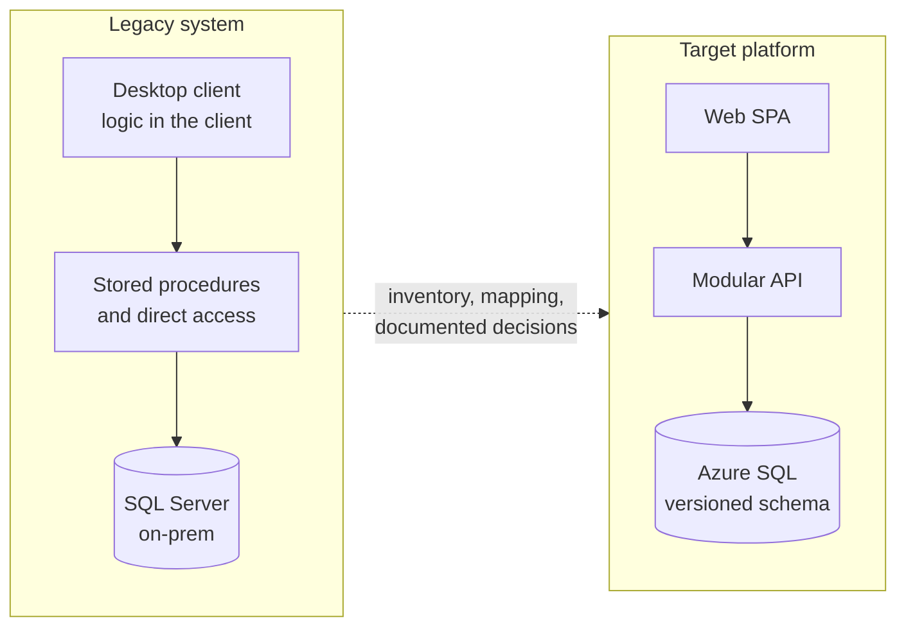

This was not a 1:1 conversion. For every table the question was **whether, how and when** to import it, and what
to do when the answer depends on someone who has not decided yet (see [§5](#5-data-migration-governance)).

What changed compared with the legacy system:

| Before | After |
|---|---|
| Business logic in the client and in the DB | Application modules with explicit contracts |
| Schema changed by hand | Schema declared in code, deployed as a DACPAC |
| SQL credentials | Managed Identity, no passwords |
| One database with no scoping | Every row belongs to a company, integrity guaranteed by the model |
| Manual releases | Immutable candidate promoted across environments |

---

## 2. Architecture

Guiding choice: a **modular monolith**, not microservices. Modules share a release cycle and the transactional
database but have explicit boundaries; a service is extracted only when load, isolation or release autonomy justify it.

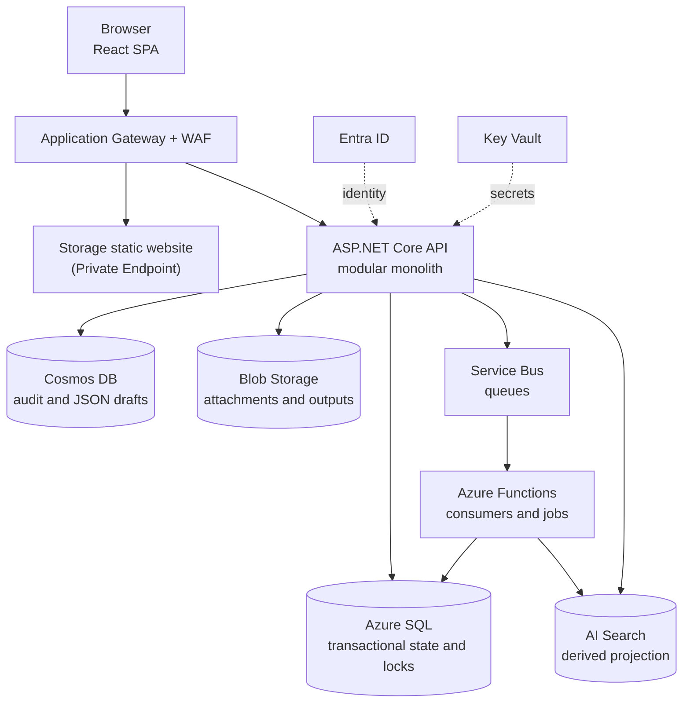

Role of each datastore:

| Datastore | Holds | Why |
|---|---|---|
| **Azure SQL** | Transactional state, authoritative locks | Relational integrity, constraints, transactions |
| **Cosmos DB** | Append-only audit and JSON drafts, partitioned by company | Flexible-schema documents, write-heavy |
| **Blob Storage** | Attachments and generated outputs | Unstructured files |
| **AI Search** | Search projection | Full-text and ranking, rebuildable from the source |

Rule: **Cosmos does not replace SQL** for transactional state and locks. Audit and drafts go through application
repositories that are independent of the SDK, so the datastore stays replaceable.

---

## 3. Database as code

The schema is never changed by hand, nor by the application at startup. It is declared in an SDK-style SQL
project and compiled into a **DACPAC** versioned together with the release.

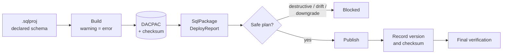

Principles applied:

- **Forward-only.** No `Down` scripts: recovery means backup or Point-in-Time Restore.
- **Expand / migrate / contract** for incompatible changes, over several releases, so the previous version
  keeps working during rollout.
- **Idempotent Pre/Post-Deployment scripts** for transformations and configuration data.
- **Automatic gates on the plan**: destructive changes, unclassifiable `Alter` operations, drift against the
  registered model and downgrades all block the release.
- **Traceability**: a database extended property records the run number and the DACPAC checksum,
  written only after verification.
- **First deploy** only on an empty database with a restore point available.

Generic example of a gate on the deploy plan (illustrative, not the original code):

```powershell
# Fail if the DeployReport contains operations that are not allowed
[xml]$report = Get-Content $deployReportPath
$ops = $report.DeploymentReport.Operations.Operation

$blocked = $ops | Where-Object {
    $_.Name -in 'Drop', 'Alter' -and $_.Item.Type -in 'SqlTable','SqlColumn'
}
if ($blocked) {
    $blocked | ForEach-Object { Write-Error "Operation not allowed: $($_.Name) $($_.Item.Value)" }
    exit 1
}
```

> Official references on drift and DeployReport are in [§14](#14-sources-and-references).

---

## 4. Multi-tenancy in the data model

Isolation between companies lives **in the model**, not only in application code. A child table cannot
point to a row belonging to another company because the foreign key is **composite** and includes the tenant.

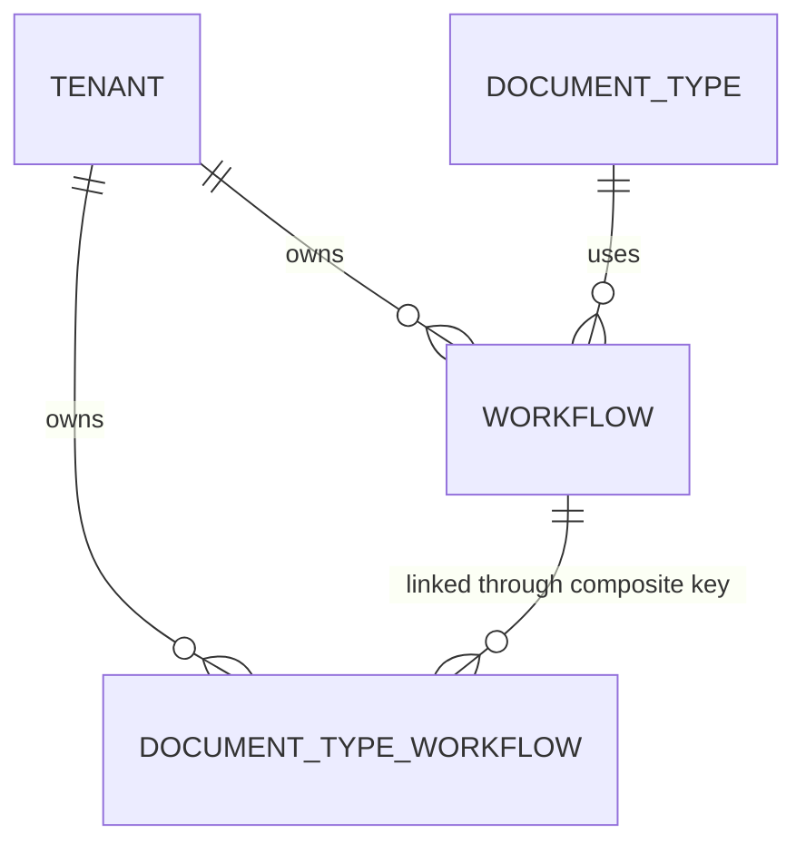

Example (rewritten in generic form): linking a document type to a workflow, with **a single default per pair**.

```sql
CREATE TABLE dbo.DocTypeWorkflow (
    Id           INT IDENTITY(1,1) NOT NULL,
    TenantId     INT         NOT NULL,
    DocTypeId    NVARCHAR(3) NOT NULL,
    WorkflowId   INT         NOT NULL,
    IsDefault    BIT         NOT NULL,
    RowVer       ROWVERSION  NOT NULL,   -- optimistic concurrency
    CONSTRAINT PK_DocTypeWorkflow PRIMARY KEY CLUSTERED (Id),
    CONSTRAINT FK_DTW_Tenant   FOREIGN KEY (TenantId)  REFERENCES dbo.Tenant (TenantId),
    CONSTRAINT FK_DTW_DocType  FOREIGN KEY (DocTypeId) REFERENCES dbo.DocType (DocTypeId),
    -- the composite key prevents linking a workflow that belongs to another company
    CONSTRAINT FK_DTW_Workflow FOREIGN KEY (TenantId, DocTypeId, WorkflowId)
        REFERENCES dbo.Workflow (TenantId, DocTypeId, WorkflowId)
);

-- At most one default per (tenant, type): filtered unique index
CREATE UNIQUE NONCLUSTERED INDEX UX_DTW_OneDefault
    ON dbo.DocTypeWorkflow (TenantId, DocTypeId) WHERE IsDefault = 1;
```

Two ideas to take away:

1. **The constraint lives in the database**, where an application bug cannot bypass it.
2. **The filtered index** expresses "at most one" without triggers. What happens when none exists is the
   application consumer's responsibility, and the code says so in a comment instead of pretending to guarantee it.

Every change of this kind comes with schema tests that read the SQL file and check constraints and indexes,
so a regression fails in CI.

---

## 5. Data migration governance

With over a hundred tables, the risk is not technical but **missing decisions**. Every table has an explicit
outcome, never an implicit one.

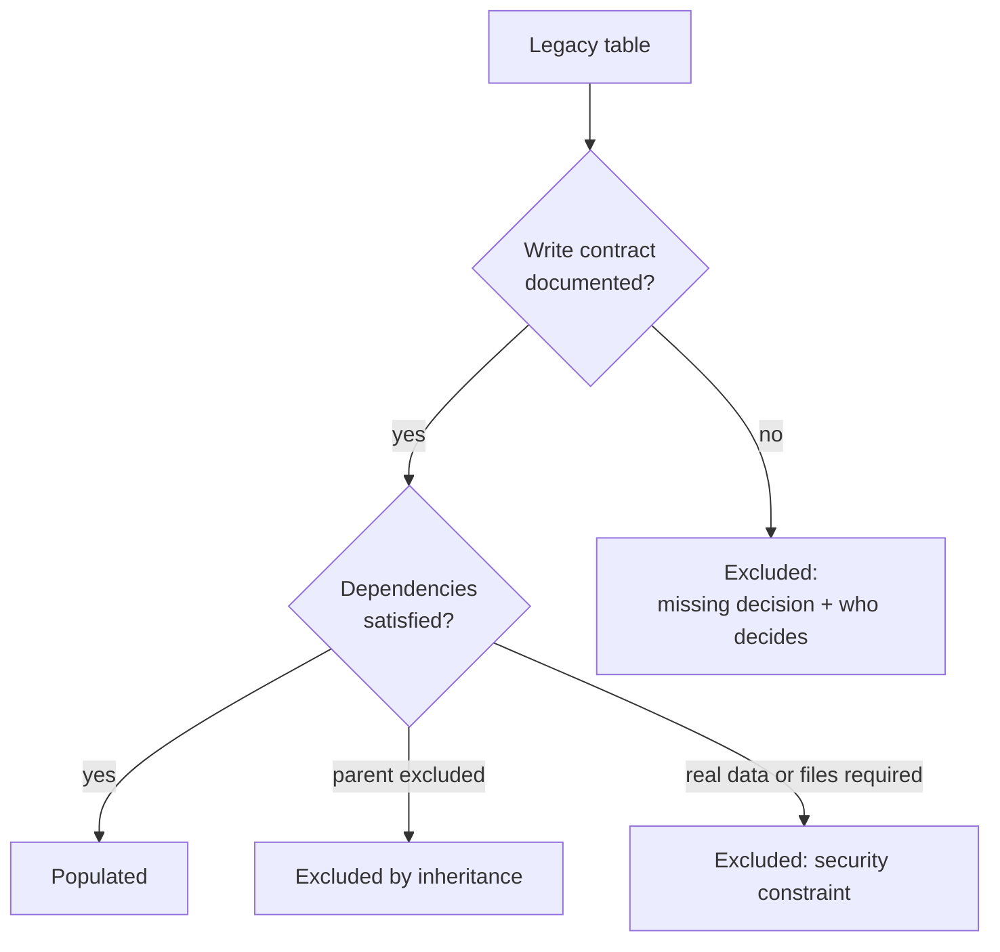

Three practices that worked:

- **Schema inventory** generated by a script, not written by hand.
- **Type conversion matrix** (hundreds of columns): for each column the source type, destination, proposed
  action and status. Unapproved technical substitutions (for example `text` → `varchar(max)`) stay flagged
  as such until accepted.
- **Decision register** linked to the blocked tables: every exclusion states *which decision blocks it*,
  *why*, and *who must make it*.

The coverage report is **generated** and compared in CI: if a new table appears in the schema without an
outcome, the check fails.

```python
# Exact coverage: every table has an outcome, none is duplicated or orphaned
classified = set(seed) | set(excluded) | set(prerequisites)
if classified != set(schema):
    raise ValueError(
        f"Inexact coverage: missing={set(schema) - classified}, "
        f"extra={classified - set(schema)}"
    )
if set(seed) & set(excluded):
    raise ValueError("A table cannot be both populated and excluded")

# In CI: the versioned report must match the regenerated one
if args.check and REPORT.read_text() != build_report(schema, seed):
    raise ValueError("Report out of date: regenerate it")
```

---

## 6. Repeatable and reversible development data

The demo dataset must be applicable many times and removable **without touching pre-existing data**.

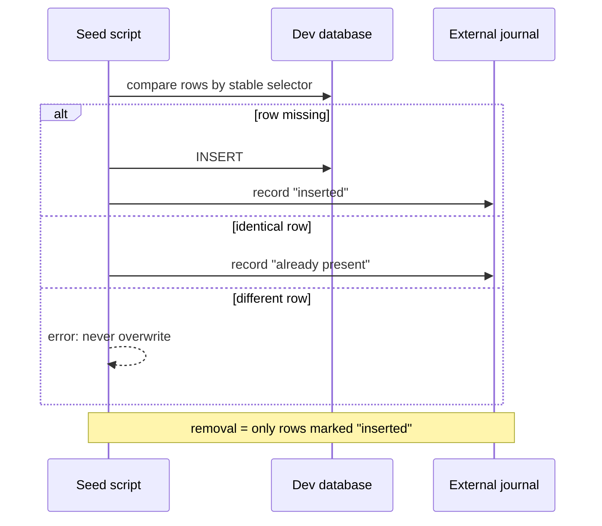

Design choices:

- A **stable selector** for every row (natural key), not the generated identity.
- **Full comparison** on re-run: if a row exists but differs, the seed stops.
- An **external journal** of inserted rows only, used for a conservative, transactional removal.
- Explicit `[DEMO]` marking and **no real data**.
- Company-scoped rows are repeated per company; global masters are not duplicated.

---

## 7. Module boundaries enforced by tests

An unchecked boundary is just an intention. The allowed references between projects are a table in code,
and a test fails if a `.csproj` adds one that is not expected.

```csharp
// Rewritten in generic form
public sealed class ProjectDependencyTests
{
    private static readonly IReadOnlyDictionary<string, string[]> Allowed =
        new Dictionary<string, string[]>
        {
            ["Orders.Application"]    = ["Shared.Abstractions", "Identity.Application"],
            ["Orders.Infrastructure"] = ["Orders.Application", "Persistence"],
            ["Orders.Presentation"]   = ["Orders.Application", "Presentation.Abstractions"],
        };

    [Fact]
    public void Every_project_references_only_allowed_projects()
    {
        foreach (var (project, allowed) in Allowed)
        {
            var actual = ReadProjectReferences(project);       // reads the .csproj
            Assert.Empty(actual.Except(allowed));              // nothing outside the list
        }
    }
}
```

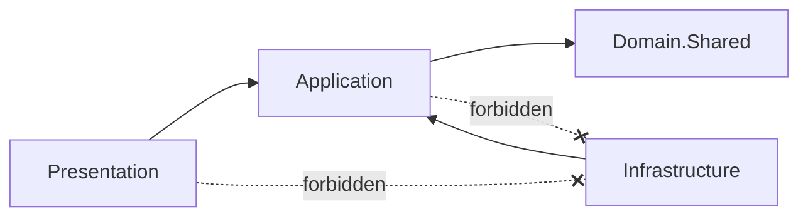

Benefit: a module cannot reach into another module's internals without CI flagging it.

---

## 8. CI/CD pipeline

Two distinct phases: **CI produces an immutable candidate**, **promotion moves it** across environments
without rebuilding it.

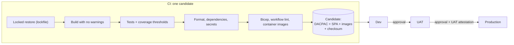

Controls in place:

| Area | Control |
|---|---|
| Reproducibility | Restore with frozen lockfile (pnpm and NuGet in locked mode), pinned SDK versions |
| Quality | Warnings as errors, formatting, strict types, coverage thresholds |
| Supply chain | NuGet and npm dependency audit, image scanning with Trivy |
| Secrets | Source scanning with Gitleaks |
| Infrastructure | Bicep compilation, workflow linting with actionlint, offline contract tests |
| Release | Candidate verified by checksum, reused on retry, never overwriting a tag with different content |

Pipeline authentication **with no secrets**: OIDC federation to Azure, with the token renewed after long
operations.

```yaml
# Simplified promotion schema (illustrative)
promote:
  environment: UAT                       # manual approval
  permissions: { id-token: write, contents: read }
  steps:
    - uses: azure/login@v2               # OIDC, no client secret
    - run: verify-candidate --run ${{ inputs.source_run_id }}   # checksum and attestations
    - run: deploy-infrastructure --what-if-first                # plan + apply
    - run: sqlpackage /Action:DeployReport ...                  # plan, then gate
    - run: sqlpackage /Action:Publish ...                       # only if the plan is allowed
    - run: promote-candidate --no-rebuild                       # same bytes as CI
```

**CI idempotency**: if a complete candidate is already published it is verified and reused; if publishing was
partial, existing tags are verified before publishing the missing ones.

---

## 9. Security: identity and least privilege

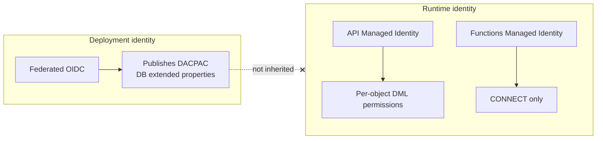

Principles:

1. **No passwords**: connections use Managed Identity and verified TLS.
2. **Separate identities**: whoever deploys the schema is not who uses it at runtime. Deployment permissions
   never pass to the workload.
3. **Versioned grant contract**: a file lists, per object, whether the runtime gets read-only, read and
   update, or read and write. No administrative roles, no automatic access to new tables.
4. **Negative verification**: a workflow checks not only that the expected permissions exist, but that the
   unexpected ones are absent, and that there is no security drift.
5. **Private network**: Private Endpoints and per-subnet NSG rules towards only the required datastores
   (HTTPS for Blob/Cosmos/Search, 1433 for SQL).

```jsonc
// Grant contract (generic form)
{
  "runtimeRole": "AppRuntime",
  "readOnly":   ["Tenant", "DocType", "Workflow"],
  "readUpdate": ["OrderLine", "Resource"],
  "readWrite":  ["Customer", "Contact", "Catalog"]
}
```

This contract must be reviewed whenever the runtime's SQL operations change: it is a project artifact, not a
forgotten configuration.

---

## 10. Tests on an ephemeral database

Tests that touch SQL never use shared databases. A dedicated runner:

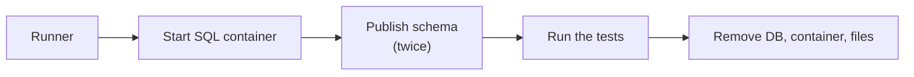

- Builds the DACPAC from the **same sources** as the Azure target.
- Produces DeployReport and script **before** the publish.
- **Applies the schema twice** to prove idempotency.
- Always cleans up, even on failure.
- Uses neither `EnsureCreated` nor ORM migrations: it tests the schema that will actually reach production.

---

## 11. Search as a derived projection

Global search uses **AI Search**, but the index is not a source of truth.

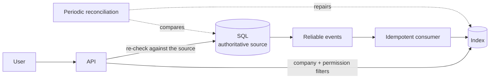

- The index is **derived and rebuildable**, with projections over an allowlist of fields.
- **Fail closed**: if a result cannot be verified against the authoritative source, it is not returned.
- An indexing failure **does not roll back the transaction** and is not presented as success.
- Periodic reconciliation recovers lost events and removes stale results.
- No embeddings or RAG: the choice was to reduce the risk surface.

---

## 12. Decisions and trade-offs

| Decision | Rejected alternative | Reason |
|---|---|---|
| Modular monolith | Microservices | Less distributed complexity; boundaries already enforced by tests |
| DACPAC + SqlPackage | ORM migrations | The schema is a release artifact with an inspectable plan |
| Forward-only | `Down` scripts | Real data rollback is a restore, not a script |
| Cosmos with shared throughput | Serverless | Serverless unavailable in the chosen region; known minimum cost |
| Immutable candidate | Rebuild per environment | What is proven in UAT is what goes to production |
| Explicit table exclusion | "Best effort" seed | An invented record is worse than a missing one |

What I learned:

- The most expensive work was not writing code but **making missing decisions explicit** and saying who has to make them.
- **Schema tests that read the SQL** are cheap and prevent silent regressions on constraints.
- A gate that blocks is only useful if the message says **what to do next**.

---

## 13. Skills demonstrated

| Area | Evidence |
|---|---|
| **Data modeling** | Composite keys for isolation, filtered indexes, optimistic concurrency |
| **Data migration** | Inventory, type conversion matrix, decision register, coverage verified in CI |
| **Database DevOps** | DACPAC, DeployReport, drift gate, forward-only, expand/contract |
| **Cloud / IaC** | Modular Bicep, private networks, Private Endpoints, NSG, Application Gateway + WAF |
| **CI/CD** | Immutable candidate, OIDC without secrets, per-environment promotion, idempotent reruns |
| **Security** | Managed Identity, per-object least privilege, negative permission checks |
| **Data stores** | Reasoned choice among SQL, Cosmos, Blob, Search |
| **Quality** | Ephemeral-DB tests, architecture tests, coverage thresholds, secret and image scanning |

---

## 14. Sources and references

Practices for building a portfolio repository:

- [How to Build a Data Engineering Portfolio That Gets Interviews](https://dataengineeracademy.com/blog/how-to-build-a-data-engineering-portfolio-that-gets-interviews-5-project-types-recruiters-understand/)
- [Checklist: building a cloud data engineer portfolio](https://www.dataexpert.io/blog/checklist-building-cloud-data-engineer-portfolio)
- [The Data Engineer's GitHub Portfolio (2026 Edition)](https://pipeline2insights.substack.com/p/how-to-create-data-engineering-data-engineers-github-portfolio-in-2026)

Database DevOps on Azure SQL:

- [Detect and resolve schema drift (Microsoft Learn)](https://learn.microsoft.com/en-us/training/modules/implement-cicd-sql-database-projects/05-detect-resolve-schema-drift)
- [SqlPackage DriftReport (Microsoft Learn)](https://learn.microsoft.com/sql/tools/sqlpackage/sqlpackage-deploy-drift-report)
- [Implement CI/CD by using SQL Database Projects (Microsoft Learn)](https://learn.microsoft.com/en-us/training/modules/implement-cicd-sql-database-projects)

Module boundaries:

- [Make Bad Architecture Fail the Build (architecture testing in .NET)](https://www.dotnet-guide.com/tutorials/software-architecture/architecture-testing-dotnet/)

Diagrams:

- All the diagrams in this repository are written in [Mermaid](https://mermaid.js.org/), rendered natively by GitHub.

> The portfolio sources are training blogs: read them as practical guidance, not as standards.
> I did not find a specific Microsoft guide for expand/contract with DACPAC: the sequence described here is
> the approach adopted in the project, not an official recommendation.

---

## Note

The code examples are illustrative and written from scratch to explain the concepts; table and module names are generic.
